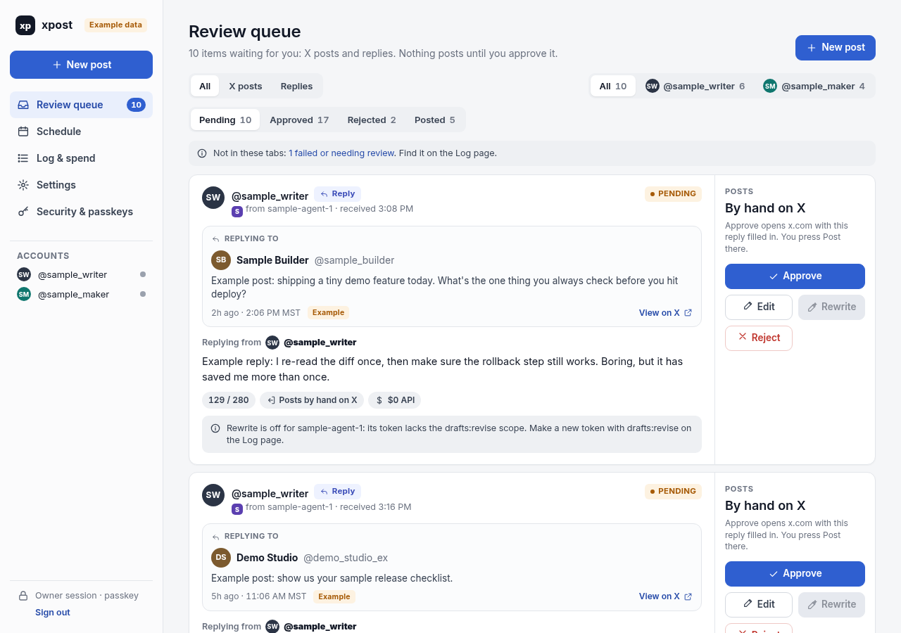

# xpost

xpost is a self-hosted review queue for X posts. Agents (scripts, bots, AI
assistants) propose drafts through an API with scoped tokens. You review,
edit, approve, reschedule or reject them in a web UI. Approved posts go out
at their scheduled time through your own X developer app.

- One Go binary. SQLite storage (pure Go, no cgo).
- Owner sign-in is a password plus a passkey. There is no public sign-up.
- Posting is off by default and fails closed: nothing posts until you turn
  the scheduler on, set cost rates, and set a monthly spend cap.
- Threads, up to 4 images (or 1 GIF) per post, alt text.
- Replies are approved in xpost but posted by you on x.com (see
  [X API terms](#x-api-terms)).
- Blogs are optional. See [Blogs](#blogs-optional).

License: MIT. See [LICENSE](LICENSE).

## Screenshot



The review queue, from a local demo with sample data. Nothing here is a real X account or post.

## Quickstart: local demo

The demo runs on your machine with invented data and a fake X. It never
contacts X.

You need Go (the version in `go.mod`), git, and a browser that supports
passkeys. Passkeys work on `http://localhost` without https.

```sh
git clone https://github.com/scott/xpost.git
cd xpost
go build -o xpost ./cmd/xpost
./xpost version
```

Create a master key and a demo database in a scratch directory:

```sh
mkdir -p demo && cd demo
umask 077 && ../xpost keygen > xpost.key     # local secret, never commit it
export XPOST_KEY_FILE=$PWD/xpost.key
export XPOST_COST_POST_USD=0 XPOST_COST_LINK_POST_USD=0     # demo only: the fake poster
export XPOST_COST_MEDIA_UPLOAD_USD=0 XPOST_COST_MEDIA_METADATA_USD=0

../xpost create-owner -email you@example.com -name "Demo Owner" -tz UTC
#   prints a one-time setup link, valid 72 hours
../xpost seed-demo
#   adds example drafts, blogs, replies and log rows (invented data only)
```

Optional: start the fake X so the Connect button works. In a second terminal,
from the repo root:

```sh
go run ./cmd/xpost-fakex -addr 127.0.0.1:8099
```

It prints `XPOST_X_*` lines. Export each one in the terminal that runs
`serve` (prefix each line with `export `). Its consent page has one button
per demo account. Pick the button that matches the account you pressed
Connect on; xpost refuses a different account.

Start the server:

```sh
../xpost serve -addr 127.0.0.1:8090 -insecure-cookies -demo -fake-poster
```

Open the setup link from `create-owner` (it starts with
`http://localhost:8090/setup/`). Set a password, then create a passkey. You
land on the review queue with an "Example data" badge.

What the flags do:

- `-insecure-cookies` allows cookies over plain http. Local use only.
- `-demo` shows the Example data badge.
- `-fake-poster` runs the dispatcher with a fake poster that never calls X.
  It only runs when the base URL is loopback. Like the real poster, it holds
  everything until cost rates are set and a monthly cap is set in Settings.
  The demo sets every `XPOST_COST_*` rate to `0`, so once you set any cap,
  due approved drafts are marked posted with fake ids. Never use `0` rates
  with the real poster unless X really charges nothing.

Blogs are off by default. To see the example blogs too, also
`export XPOST_BLOGS_ENABLED=1` before `serve`.

Lost the link or the passkey? `../xpost setup-link` prints a new one.

Port 8090 taken? Pass the new port to both commands, for example
`-addr 127.0.0.1:18090` on `serve` and `-base-url http://localhost:18090` on
`create-owner` or `setup-link` (or set `XPOST_BASE_URL` for all of them).

`GET /healthz` answers `{"ok":true,"version":"..."}` without a session.

To reset the demo, stop `serve` and delete the `demo` directory.

## Self-host on Ubuntu

Full steps: [deploy/INSTALL.md](deploy/INSTALL.md).

You need an Ubuntu (or Debian) server with systemd, a DNS name pointing at
it, and ports 80 and 443 open. Passkeys need https; the installer sets up
Caddy for that.

1. Copy `deploy/bootstrap.sh` to the server (and `.env.example` if you
   install from a checkout), then run it as root:

   ```sh
   sudo bash bootstrap.sh --domain xpost.example.com --email you@example.com --owner-email you@example.com
   ```

   It creates the `xpost` user, generates the master key once, writes
   `/etc/xpost/env` from `.env.example`, installs the systemd unit and a Caddy
   site, starts both, checks `/healthz`, and prints the owner's one-time
   setup link. Without `--binary FILE` it downloads the release binary for
   your CPU and checks it against `SHA256SUMS`. Re-running it is safe. Run
   `bash bootstrap.sh --help` for every option.

2. Open the setup link. Set a password and add a passkey.

3. A fresh install has no X accounts. In **Settings > X accounts**, type the
   handle you post as under "Add an X account" and press **Add account**.
   Agents can propose drafts only for accounts added there.

4. Connect X: set `XPOST_X_CLIENT_ID` and `XPOST_X_CLIENT_SECRET_FILE` in
   `/etc/xpost/env`, run `systemctl restart xpost`, register the callback URL
   shown in Settings > X accounts with your X app, then press **Connect**.
   See [docs/x-accounts.md](docs/x-accounts.md).

5. Posting stays off until you set the cost rates, set
   `XPOST_SCHEDULER=on`, restart, and set a monthly cap under **Settings**.
   Blogs stay off unless `XPOST_BLOGS_ENABLED=1`.

Backups: `xpost backup -out FILE` writes an integrity-checked copy of the
database (the file must not exist yet).

## Configuration

Every setting is an environment variable, listed with comments in
[`.env.example`](.env.example) (key names only). On a server it becomes
`/etc/xpost/env`; edit it, then `systemctl restart xpost`. Secrets come only
from the environment or a file outside the repo.

`serve` flags with no env key: `-insecure-cookies`, `-trust-proxy` (use
`X-Forwarded-For` from a proxy on 127.0.0.1), `-demo`, `-fake-poster`.

The monthly spend cap is not an env setting. The owner sets it in Settings.
There is no default cap.

## Commands

```
xpost serve          run the web app and agent API
xpost create-owner   create the owner; prints a one-time setup link
xpost setup-link     print a new setup link (resets the password)
xpost seed-demo      add invented example data (never on a real install)
xpost backup -out F  write an integrity-checked copy of the database
xpost keygen         print a new random master key
xpost version        print the version
```

`xpost version` prints `xpost dev` for a local build. Release builds
(`scripts/build-release.sh <version> <outdir>`, which stamps the version and
writes `SHA256SUMS`) print `xpost <version>`.

## Agent API

Create a token under **Log & spend > Agent tokens**. It is shown once.
Drafts must name an account added under Settings > X accounts; any other
account is refused.
Scopes: `drafts:write`, `log:read`, `drafts:revise`. No scope can approve,
edit an approved draft, or post.

```sh
curl -H "Authorization: Bearer $XPOST_TOKEN" -H 'Content-Type: application/json' \
  -d '{"account":"example","proposed_at":"2026-12-01T16:00:00Z","parts":[{"text":"Example"}]}' \
  http://localhost:8090/api/v1/drafts
```

Main routes: `POST /api/v1/drafts`, `GET /api/v1/drafts`,
`GET /api/v1/drafts/{id}`, `DELETE /api/v1/drafts/{id}`,
`POST /api/v1/media`, `POST /api/v1/drafts/{id}/revise`, `GET /api/v1/log`.

## Blogs (optional)

xpost can also queue blog posts for review and publish them. The feature is
off unless `XPOST_BLOGS_ENABLED=1`; then you add blogs under **Settings >
Blogs**. Nothing leaves the server unless `XPOST_BLOG_LIVE=1` too. Details:
[docs/blogs.md](docs/blogs.md).

Two kinds of blog:

- **Publisher API blog.** xpost publishes through the blog host's API with a
  sealed token.
- **Webhook blog.** xpost sends a signed wake to your agent, which pulls the
  post from the agent API and publishes it (for example by opening a pull
  request on the site's repo). xpost then checks the live page.

`XPOST_BLOG_IMPORT=1` turns on a read-only import of posts already live on a
blog. It has a dry run first and never writes to the site.

For a local try, `go run ./cmd/xpost-fakegander -token-file FILE` serves a
fake Publisher API over TLS on `127.0.0.1:8743`. The file must hold a token of
32 or more bytes. It writes a throwaway certificate (`-cert-out`, default
`fakegander.pem`); set `SSL_CERT_FILE` to that file for the demo `serve`
process only.

## X API terms

xpost talks to the X API with your own developer app and your accounts'
tokens. You are responsible for following the
[X Developer Agreement and Policy](https://docs.x.com/developer-terms/policy).

- **User tokens.** Each account connects with OAuth 2.0 (authorization code
  with PKCE) as itself. Scopes: `tweet.read users.read tweet.write
  media.write offline.access`. Tokens are encrypted with the master key and
  refresh on their own. Disconnect revokes them at X. See
  [OAuth 2.0](https://docs.x.com/fundamentals/authentication/oauth-2-0/overview).
- **Rate limits.** A 429 waits until X's `x-rate-limit-reset`. xpost spaces
  posts on one account at least 15 minutes apart and never re-sends a post
  whose outcome is unknown; you check X and mark it. See
  [rate limits](https://docs.x.com/x-api/fundamentals/rate-limits).
- **Replies are handed off.** Approving a reply never posts it through the
  API. xpost opens an X intent link (`/intent/post` with the text and
  `in_reply_to` filled in); you press Post on x.com, then mark it posted in
  xpost. Replies add $0 to the spend estimate. xpost never fetches the
  original post; the agent supplies what it read.
- **Spend caps.** X API usage is billed. xpost ships no prices: you set the
  `XPOST_COST_*` rates from your own developer console and a monthly cap in
  Settings, and nothing posts past the cap. Current prices:
  [X API pricing](https://docs.x.com/x-api/getting-started/pricing).

## Docs

- [Posting rules](docs/posting-rules.md): fail-closed posting, spacing, retries, the Posted tab, cost rates
- [Images](docs/images.md): intake limits, upload at post time, cost
- [Replies](docs/replies.md): proposing replies, intent link hand-off, errors
- [Agent API](docs/api.md): every route, scopes, request bodies
- [Webhooks](docs/webhooks.md): signatures, rewrite requests, blog publish wakes
- [Blogs](docs/blogs.md): Publisher API and webhook blogs, import
- [X accounts](docs/x-accounts.md): developer app setup, Connect, endpoint overrides, the fake X
- [Live updates](docs/live-updates.md): the event stream, limits, proxies

## Contributing and security

See [CONTRIBUTING.md](CONTRIBUTING.md). Report vulnerabilities privately, as
described in [SECURITY.md](SECURITY.md).
